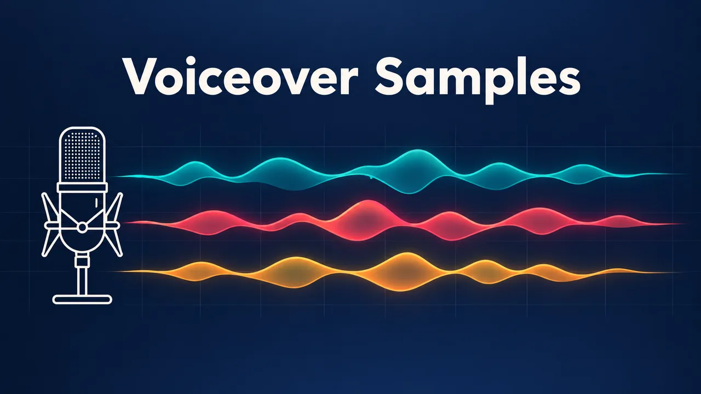

# AI Voiceover Generator Skill

[English](./README.md) | [简体中文](./README.zh-CN.md) | 日本語

> 👉 こちらもどうぞ [AI Voice Cloning Skill](https://github.com/beatra-ai/ai-voice-cloning-skill)

声を選ぶか再利用し、台本を編集に使えるナレーションにし、長編や多言語の音声を計画し、再利用できるカスタムボイスを作成。Claude Code、Cursor、Codex、Windsurf、Cline、OpenClaw のどれからでもそのまま使えます。

> [!IMPORTANT]
> 生成には [Beatra](https://beatra.ai?utm_source=github&utm_medium=flagship&utm_campaign=ai-voiceover-generator-skill) アカウントが必要で、クレジットを消費します。スキル自体のインストールは無料です。

| 項目 | 内容 |
| --- | --- |
| **できること** | 用途に合う声を選び、原稿から編集に使えるナレーションを作成。長編や多言語の読み上げ、カスタム音声の作成と再利用も一つの入口で進めます。 |
| **モデル** | MiniMax Voice Clone、MiniMax Speech 2.8 HD、MiniMax Speech 2.8 Turbo |
| **動作要件** | Python 3.10 以上と、`SKILL.md` を読み込めるエージェント |
| **費用** | インストールは無料。生成のたびに Beatra アカウントのクレジットを消費しますが、課金されるのは、その生成を明示的に依頼したとき、または確認カードを承認したときだけです。 |
| **対応エージェント** | Claude Code、Cursor、Codex、Windsurf、Cline、OpenClaw |

<p align="center"></p>

*マイクと、サンプルの 3 つの声に対応する 3 色の波形を描いたナレーションスタジオのカバー。Beatra AI で生成。*

| Skill | Entry point | Version |
| --- | --- | --- |
| [`voiceover-narration-studio`](skills/voiceover-narration-studio) | [SKILL.md](skills/voiceover-narration-studio/SKILL.md) | 0.2.9 |

このリポジトリは [beatra-ai/beatra-skills](https://github.com/beatra-ai/beatra-skills/tree/main/skills/voiceover-narration-studio) から自動的に公開されています。問題の報告はそちらへお願いします。

## インストール

[`skills`](https://skills.sh) CLI を使う場合：

```bash
npx skills add beatra-ai/ai-voiceover-generator-skill
```

Claude Code プラグインとして：

```bash
claude plugin marketplace add beatra-ai/ai-voiceover-generator-skill
claude plugin install voiceover-narration-studio@ai-voiceover-generator-skill
```

Codex プラグインとして：

```bash
codex plugin marketplace add beatra-ai/ai-voiceover-generator-skill
codex plugin add voiceover-narration-studio@ai-voiceover-generator-skill
```

GitHub Copilot CLI プラグインとして：

```bash
copilot plugin marketplace add beatra-ai/ai-voiceover-generator-skill
copilot plugin install voiceover-narration-studio@ai-voiceover-generator-skill
```

Gemini CLI 拡張機能として：

```bash
gemini extensions install https://github.com/beatra-ai/ai-voiceover-generator-skill
```

GitHub CLI を使う場合：

```bash
gh skill install beatra-ai/ai-voiceover-generator-skill voiceover-narration-studio
```

または、このリポジトリをクローンして `skills/voiceover-narration-studio` を次の場所にコピーします：Claude Code は `~/.claude/skills/`、Cursor は `~/.cursor/skills/`、Codex は `~/.agents/skills/`、Windsurf は `~/.codeium/windsurf/skills/`、Cline は `~/.cline/skills/`、OpenClaw は `~/.openclaw/skills/`。

または、次の文をエージェントに貼り付けてください：

```text
https://github.com/beatra-ai/ai-voiceover-generator-skill から voiceover-narration-studio スキル（フォルダ skills/voiceover-narration-studio）をインストールし、その SKILL.md に従って私の Beatra アカウントに接続してください。
```

## 作例

<p align="center"></p>

[▶ 試聴する（MP3）](assets/sample.mp3)

*3 つのプリセットボイスによる短い読み上げ 3 本。順に、落ち着いた製品説明、明るいショート動画広告、ドキュメンタリーの一文。合計 41 秒。Beatra AI で生成。*

エージェントへの依頼例：

```text
この 3 本の短い原稿を、それぞれ別のプリセットボイスで読んで：Tidewell デスクランプの落ち着いた製品説明、Crunchlane チップスの明るいショート動画広告、ドキュメンタリーの一文。この順番で 3 本納品して。
```

プロンプト：

```text
Meet Tidewell, a desk lamp that follows your day. In the morning, it glows cool and bright for focus. After sunset, it turns warmer, so your eyes can rest.

Okay, stop scrolling! Crunchlane spicy mango chips are here: sweet, hot, and seriously crunchy. Grab a bag this Saturday, and tell us how fast it disappeared!

High in the northern mountains, the first snow falls without a sound. A red fox stops and listens. Something small is moving beneath the snow. She waits. Then she leaps.
```

## 技術仕様と出力上限

2026-10-18 時点。最新の一覧：https://docs.beatra.ai/ja/docs/models

- **アップロード** — 1 ファイルあたり最大 100 MB。下記の各モデルの入力制限も適用されます
- **ボイスクローン** — 1 モデル（MiniMax Voice Clone）／サンプル 10〜300 秒、最大 20 MB／本人の同意確認が必要
- **音声合成** — 2 モデル（MiniMax Speech 2.8 HD、MiniMax Speech 2.8 Turbo）／FLAC、MP3、OPUS、PCM、WAV／40 言語／サンプルレート 8、16、22.05、24、32、44.1 kHz／1 リクエストあたり最大 50000 文字
  - 言語（ISO 639 コード）：zh, yue, en, es, fr, ru, de, pt, ar, it, ja, ko, id, vi, tr, nl, uk, th, pl, ro, el, cs, fi, hi, bg, da, he, ms, fa, sk, sv, hr, fil, hu, no, sl, ca, nn, ta, af

## 得られるもの

- **目的に合う進め方を選ぶ** — 短い読み上げ、長編、多言語の原稿、再利用できるカスタム音声をわかりやすく選べます。
- **選んだ声を使い続ける** — 言語と用途に合う候補だけを比較し、継続するコンテンツでは同じ選択を保ちます。
- **長編音声をわかりやすく整理** — 章、教材、言語、継続する用途ごとに音声を整理し、納品された各項目を見つけやすく、編集しやすくします。

## 活用シーン

- **動画ナレーション** — 原稿から、視聴者に合う声とテンポで編集に使える一つの読み上げ音声を作ります。
- **オーディオブック・教材ナレーション** — 代表的な一節を先に聞き、選んだ声で章や教材の順番を保ちます。
- **多言語の読み上げ音声** — 用意済みの各言語原稿に合う声を選び、言語と章ごとに分けて仕上げます。
- **再利用できるカスタム音声** — 一人が話すクリアなサンプルから名前付きの声を作り、今後の原稿にも選べます。

## よくある質問

### どのような音声を作れますか？

一つの動画ナレーション、順番のあるオーディオブックや教材、多言語原稿による読み上げ、再利用できるカスタム音声を作れます。

### どの言語に対応していますか？

現在の音声合成モデルは40言語に対応し、中国語（標準語）、広東語などを含みます。制作ごとに、現在選んだ声と音声合成モデルの両方が対象言語に対応するか確認します。

### 自分の声を使えますか？

はい。一人が話すクリアなサンプルから名前付きの声を作り、後のナレーション、教材、お知らせ、継続するブランドコンテンツにも選べます。

### 長編や多言語の音声はどう整理されますか？

章、教材、言語、市場、継続する用途ごとに音声を整理し、各項目を確認、編集、再利用しやすくします。

## 更新とセキュリティ

2026 年 10 月のリリース以降、このスキルに自動更新機能はありません。インストールしたファイルだけを実行し、
自動的に置き換えることはありません。更新はインストールに使ったツール（`npx skills update voiceover-narration-studio` または
`gh skill update voiceover-narration-studio`）で行ってください。詳細はスキル内の `references/updates-and-security.md` を参照してください。

## ライセンス

[MIT-0](LICENSE)：商用を含め、自由に使用・改変・再配布できます。クレジット表記は不要です。ClawHub 上のこれらのスキルと同じ条件です。

## リンク

- ウェブサイト — https://beatra.ai?utm_source=github&utm_medium=flagship&utm_campaign=ai-voiceover-generator-skill
- ドキュメント — https://docs.beatra.ai?utm_source=github&utm_medium=flagship&utm_campaign=ai-voiceover-generator-skill
- コンソール — https://console.beatra.ai
- AI エージェント向け — https://beatra.ai/llms.txt （インデックス）· https://beatra.ai/llms-full.txt （全スキルを 1 ファイルに）
